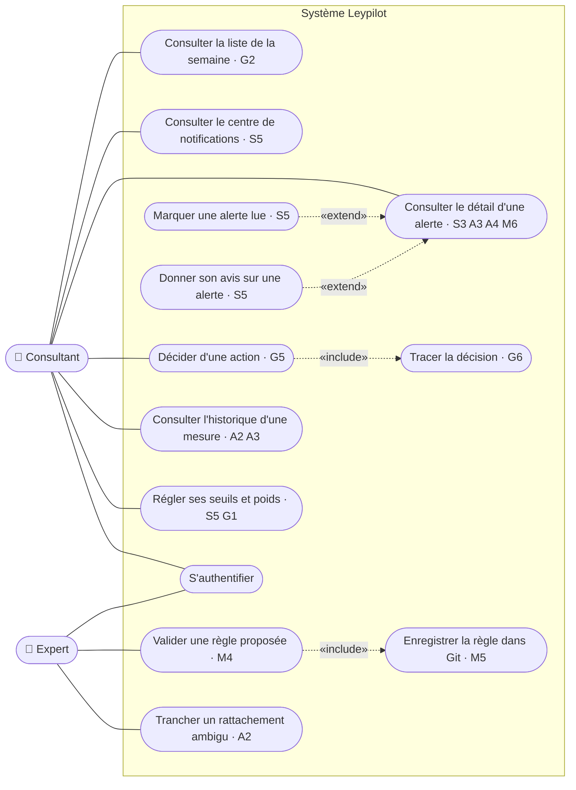
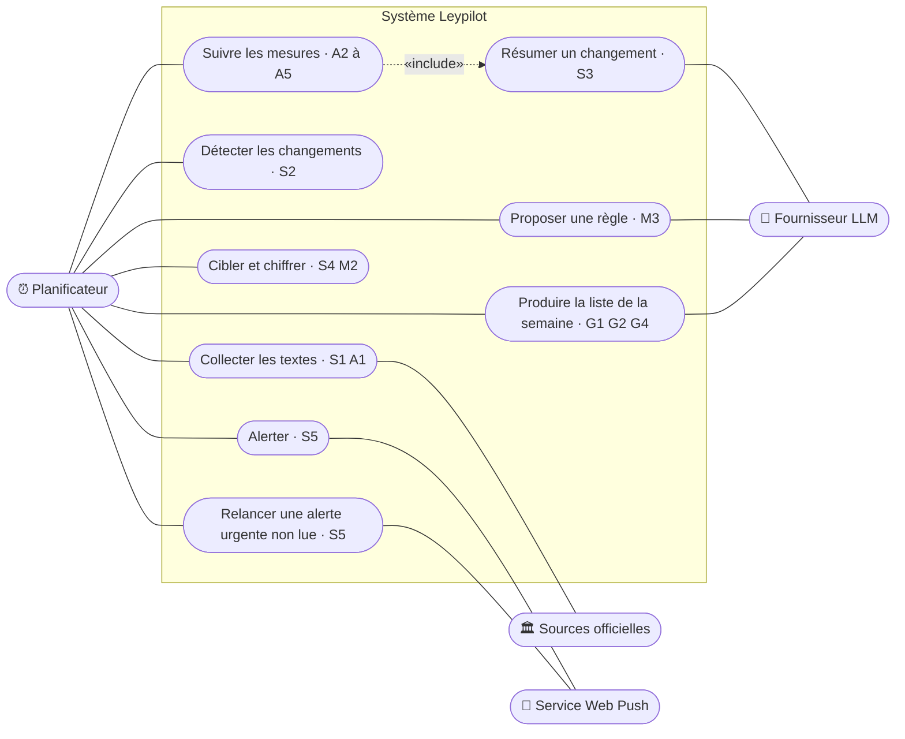

# 1 · Acteurs et cas d'utilisation

## Acteurs

| Acteur | Type | Rôle dans Leypilot | Ce qu'il voit |
|---|---|---|---|
| **Consultant** | Humain, principal | Reçoit les alertes, décide des actions, règle ses seuils | Son portefeuille uniquement (règle de gestion 6) |
| **Expert** | Humain | Valide les règles de calcul (M4) et les rattachements ambigus (A2) | Les règles et les mesures, jamais les données client |
| **Planificateur** | Système (horloge) | Lance les tâches de nuit, la liste du dimanche et les relances | — |
| Sources officielles | Système externe | Fournissent les textes : Légifrance (PISTE), Assemblée nationale, Sénat, BOFiP | — |
| Fournisseur LLM | Système externe | Rédige citations, résumés, brouillons de règles et phrases d'action ; ne reçoit que des textes publics | — |
| Service Web Push | Système externe | Achemine les notifications urgentes vers le navigateur du consultant | — |

Le **client de Leyton** n'est pas un acteur : il n'a aucun contact avec Leypilot (règle de gestion 4).

## Diagramme des cas d'utilisation

Deux vues : ce que font les humains, puis ce que Leypilot fait seul, chaque nuit ou chaque semaine.

### Vue 1 · Consultant et expert

Toutes les fonctions supposent l'authentification (non tracée pour chaque cas). « Marquer lue » et « Donner son avis » sont facultatifs depuis le détail d'une alerte (`«extend»`) ; une décision entraîne toujours sa trace (`«include»`).

### Vue 2 · Traitements automatiques

« Proposer une règle » ne se déclenche que pour une mesure publiée au JO. Le LLM sert aussi, en secours, à la détection (S2) et à la datation (A4).

## Cas d'utilisation par lot

| Cas d'utilisation | Acteur | Fonctions | Lot |
|---|---|---|---|
| Collecter les textes | Planificateur | S1, A1 | P1 |
| Détecter les changements | Planificateur | S2 | P1 |
| Suivre les mesures, résumer | Planificateur | A2 à A5, S3 | **P2** |
| Trancher un rattachement ambigu | Expert | A2 | **P2** (écran P5) |
| Consulter l'historique d'une mesure | Consultant | A2, A3 | **P2** (écran P5) |
| Cibler et chiffrer | Planificateur | S4, M2 | P3 |
| Proposer une règle | Planificateur | M3 | P3 |
| Valider une règle proposée | Expert | M4, M5 | P3 (écran P5) |
| Alerter, relancer | Planificateur | S5 | P4 |
| Produire la liste de la semaine | Planificateur | G1, G2, G4 | P4 |
| Consulter liste, notifications, détail ; avis ; réglages | Consultant | S5, G2, M6 | P4 (écrans P5) |
| S'authentifier | Consultant, expert | Socle | P5 |
| Décider d'une action, tracer | Consultant | G5, G6 | P5 |

## Fiches des cas principaux

### CU-01 · Décider d'une action (G5, G6)

| | |
|---|---|
| **Acteur** | Consultant |
| **Déclencheur** | Le consultant ouvre une action depuis la liste de la semaine ou une notification |
| **Préconditions** | Le consultant est authentifié ; l'action appartient à un client de son portefeuille ; la mesure est au moins votée (A5) |
| **Scénario nominal** | 1. Le système affiche l'action : client, montant en jeu, délai, phrase conseillée, résumé, citation, trace du calcul. 2. Le consultant choisit Accepter, Reporter ou Rejeter. 3. Le système exige un motif. 4. Le consultant saisit le motif et valide. 5. Le système change le statut de l'action et écrit une ligne dans `journal_decision` (qui, quoi, quand, pourquoi, commit des règles). |
| **Alternatives** | 2a. Reporter : le consultant choisit une date ; l'action revient dans la liste à cette date. 3a. Motif vide : le système refuse et redemande le motif. |
| **Exceptions** | L'action n'est pas dans son portefeuille : la base ne la renvoie pas (Row-Level Security). |
| **Postconditions** | Le journal contient la décision ; il ne peut plus être modifié ni supprimé. |
| **Règles** | RG4 : Leypilot ne contacte jamais le client. Aucune action ne part sans décision du consultant. |

### CU-02 · Valider une règle proposée (M4, M5)

| | |
|---|---|
| **Acteur** | Expert |
| **Déclencheur** | Une loi est publiée au JO et change un paramètre ; M3 a produit un brouillon |
| **Préconditions** | L'expert est authentifié ; la règle proposée est « en attente » |
| **Scénario nominal** | 1. Le système affiche le brouillon : paramètre, ancienne et nouvelle valeur, date d'effet, citation exacte, lien Légifrance. 2. L'expert valide. 3. Le système écrit le fichier YAML OpenFisca et le commite dans Git. 4. Le système enregistre l'identifiant du commit et passe la règle à « validée ». 5. Les impacts « en attente de validation » sont recalculés à la tâche suivante. |
| **Alternatives** | 2a. L'expert corrige une valeur, puis valide : statut « corrigée », même suite. 2b. L'expert rejette avec un motif : aucun fichier n'est écrit. |
| **Postconditions** | Le moteur ne charge que les règles validées (RG2). |

### CU-03 · Trancher un rattachement ambigu (A2)

| | |
|---|---|
| **Acteur** | Expert (à confirmer en équipe : expert ou consultant) |
| **Déclencheur** | Le score de ressemblance d'un changement avec une mesure existante est entre 70 et 90 |
| **Préconditions** | Une ligne `rattachement_a_valider` sans décision |
| **Scénario nominal** | 1. Le système montre le changement, la mesure candidate et le score. 2. L'expert confirme. 3. Le système rattache le changement à la mesure et applique la transition de statut. |
| **Alternatives** | 2a. L'expert refuse : le système crée une nouvelle mesure à partir du changement. |
| **Postconditions** | La ligne porte la décision et l'heure ; elle ne peut plus être retraitée. |

### CU-04 · Suivre une mesure (A2 à A5, S3) — automatique

| | |
|---|---|
| **Acteur** | Planificateur |
| **Déclencheur** | Tâche de nuit, après la détection (S2) |
| **Scénario nominal** | Pour chaque nouveau changement : 1. Rattacher à une mesure existante, ou en créer une (A2). 2. Appliquer la transition de statut autorisée par l'événement (A3). 3. Dater l'entrée en vigueur : certaine ou estimée (A4). 4. Résumer : citation vérifiée, rédaction, filtre anti-montant, drapeau « à vérifier » (S3). Puis, une fois par jour : passer en « appliquée » les mesures publiées dont la date est atteinte. |
| **Alternatives** | 1a. Rattachement ambigu : mise en attente (CU-03), aucun statut ne bouge. 2a. Transition interdite : la mesure est marquée « à revoir ». 4a. LLM indisponible ou réponse non conforme : résumé par gabarit. |
| **Règles** | RG1 : on prévient dès le dépôt, on n'agit que sur un texte voté (contrainte A5 en base). Le résumé ne contient jamais de montant inventé. |
