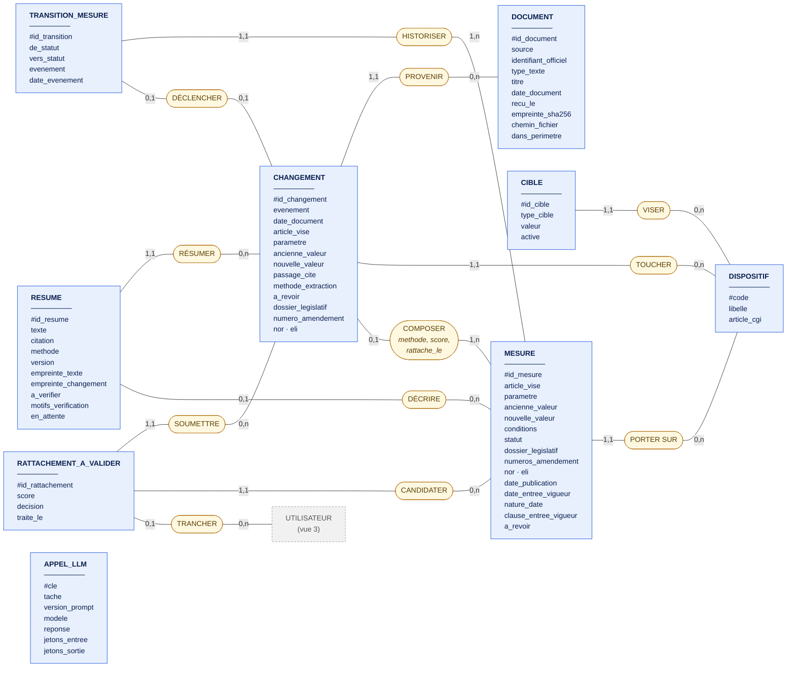
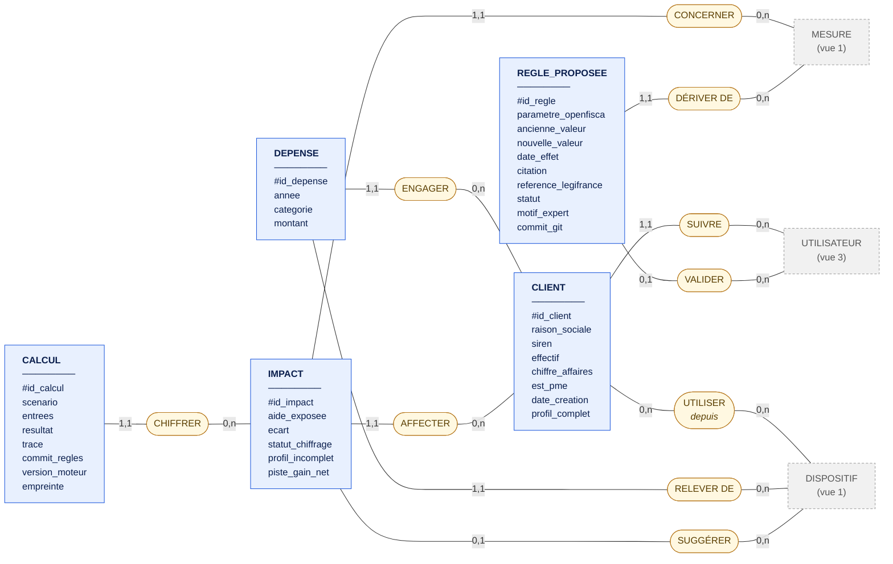
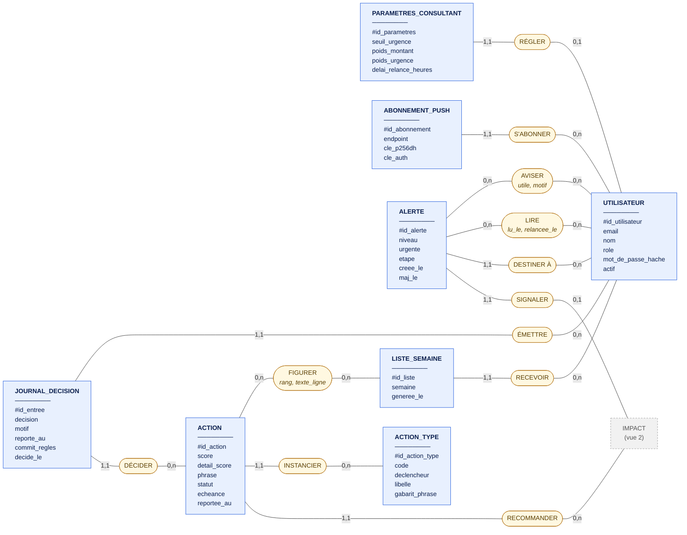

# 3 · Modèle conceptuel des données (MCD)

Le MCD décrit les données **indépendamment de la technique** : entités, associations entre elles et cardinalités. Il est lu dans le sens Merise : la cardinalité écrite près d'une entité dit combien de fois cette entité participe à l'association.

> Exemple : `CHANGEMENT (1,1) — PROVENIR — (0,n) DOCUMENT` se lit « un changement provient d'un et un seul document ; un document contient zéro, un ou plusieurs changements ».

Les 22 entités sont réparties en trois vues pour rester lisibles. Une entité grisée est détaillée dans une autre vue.

## Règles de gestion qui fondent le modèle

| N° | Règle | Traduction dans le MCD |
|---|---|---|
| R1 | Un document peut contenir plusieurs changements ; un changement vient d'un seul document. | PROVENIR (1,1)–(0,n) |
| R2 | Un changement touche un seul dispositif. | TOUCHER (1,1)–(0,n) |
| R3 | Une mesure regroupe toutes les versions d'une même modification (amendement, texte adopté, loi publiée). | COMPOSER (0,1)–(1,n) |
| R4 | Un changement ambigu n'est rattaché à aucune mesure tant qu'un humain n'a pas tranché. | COMPOSER côté changement en (0,1) ; RATTACHEMENT_A_VALIDER |
| R5 | Chaque changement de statut d'une mesure est journalisé avec son événement et sa date. | HISTORISER (1,1)–(1,n) |
| R6 | Un résumé décrit un changement, dans une version donnée du rédacteur. | RESUMER (1,1)–(0,n) |
| R7 | Un client est suivi par un seul consultant (portefeuille). | SUIVRE (1,1)–(0,n) |
| R8 | Une mesure touche zéro ou plusieurs clients ; pour chaque couple, un seul impact. | IMPACT relié à MESURE et CLIENT en (1,1) ; couple unique |
| R9 | Tout montant vient d'un calcul déterministe, versionné et rejouable. | CHIFFRER (1,1)–(0,n) |
| R10 | Une règle de calcul n'est utilisée qu'après validation par un expert. | VALIDER (0,1)–(0,n) |
| R11 | Une même mesure suivie dans plusieurs textes ne produit qu'une alerte par client. | SIGNALER (1,1)–(0,1) sur IMPACT |
| R12 | Une action n'est proposée que sur une mesure au moins votée (A5). | Contrainte sur RECOMMANDER, garantie en base |
| R13 | Toute décision du consultant est tracée : qui, quoi, quand, pourquoi. | DECIDER et AUTEUR (1,1)–(0,n) |
| R14 | Un consultant ne voit que les clients de son portefeuille. | Hérité de SUIVRE ; garanti par Row-Level Security |

## Vue 1 · Veille et suivi de la mesure (lots 1 et 2)

**Remarques**

- **MESURE est l'objet central** : elle naît du premier changement (dépôt d'un amendement) et rassemble les suivants (adoption, publication). Elle porte les identifiants officiels cumulés, et les valeurs et conditions du dernier texte : c'est ce que reçoit la personne 3 pour chiffrer.
- **COMPOSER** porte la manière dont le changement a été rattaché (par numéro d'amendement, par identifiant, par ressemblance, par un humain) et le score. Un changement non rattaché (0) est soit en attente dans RATTACHEMENT_A_VALIDER, soit un rejet sur une mesure inconnue.
- **DÉCLENCHER** est en (0,1) côté transition : le passage en « appliquée » vient de la date, pas d'un changement.
- **APPEL_LLM** n'est reliée à aucune entité : c'est le cache de la couche LLM, partagé par tous les lots. Elle ne contient que des textes publics.

## Vue 2 · Clients et chiffrage (lot 3)

**Remarques**

- **IMPACT** aurait pu être une association porteuse entre MESURE et CLIENT. On en fait une entité parce que d'autres données s'y rattachent : les calculs, l'alerte, les actions.
- Un impact a en général **trois calculs** : loi actuelle, réforme, et éventuellement l'autre dispositif (piste G3). L'écart est la différence entre les deux premiers.
- **VALIDER** relie la règle à l'expert qui l'a tranchée ; (0,1) car la règle attend d'abord. Les règles validées vivent ensuite dans les fichiers YAML du dépôt Git, pas en base : seul le commit est gardé.

## Vue 3 · Alertes, actions et plateforme (lots 4 et 5)

**Remarques**

- **SIGNALER (1,1)–(0,1)** : un impact donne au plus une alerte. Quand la mesure avance (votée, puis publiée), la même alerte est mise à jour (`etape`, `maj_le`) au lieu d'en créer une nouvelle (R11).
- **DESTINER À** recopie le consultant du client. C'est une redondance voulue : la Row-Level Security filtre l'alerte sans jointure.
- **LIRE** et **AVISER** sont des associations porteuses : elles deviennent les tables `lecture_alerte` et `avis_alerte`.
- **RECOMMANDER** est soumise à R12 : le MCD ne sait pas exprimer « mesure au moins votée », c'est une contrainte d'intégrité ajoutée au MLD (trigger A5).
- **JOURNAL_DECISION** n'accepte que des ajouts : une décision n'est jamais modifiée, une nouvelle décision s'ajoute à la suite.

## Récapitulatif des associations

| Association | Entité A (card.) | Entité B (card.) | Données portées | Devient en MLD |
|---|---|---|---|---|
| PROVENIR | CHANGEMENT (1,1) | DOCUMENT (0,n) | | `changement.document_id` |
| TOUCHER | CHANGEMENT (1,1) | DISPOSITIF (0,n) | | `changement.dispositif` |
| VISER | CIBLE (1,1) | DISPOSITIF (0,n) | | `cible.dispositif` |
| COMPOSER | CHANGEMENT (0,1) | MESURE (1,n) | methode, score, rattache_le | table `version_mesure` |
| PORTER SUR | MESURE (1,1) | DISPOSITIF (0,n) | | `mesure.dispositif` |
| HISTORISER | TRANSITION_MESURE (1,1) | MESURE (1,n) | | `transition_mesure.mesure_id` |
| DÉCLENCHER | TRANSITION_MESURE (0,1) | CHANGEMENT (0,1) | | `transition_mesure.changement_id` |
| RÉSUMER | RESUME (1,1) | CHANGEMENT (0,n) | | `resume.changement_id` |
| DÉCRIRE | RESUME (0,1) | MESURE (0,n) | | `resume.mesure_id` |
| SOUMETTRE | RATTACHEMENT_A_VALIDER (1,1) | CHANGEMENT (0,n) | | `rattachement_a_valider.changement_id` |
| CANDIDATER | RATTACHEMENT_A_VALIDER (1,1) | MESURE (0,n) | | `rattachement_a_valider.mesure_candidate_id` |
| TRANCHER | RATTACHEMENT_A_VALIDER (0,1) | UTILISATEUR (0,n) | | `rattachement_a_valider.traite_par` |
| SUIVRE | CLIENT (1,1) | UTILISATEUR (0,n) | | `client.consultant_id` |
| UTILISER | CLIENT (0,n) | DISPOSITIF (0,n) | depuis | table `client_dispositif` |
| ENGAGER | DEPENSE (1,1) | CLIENT (0,n) | | `depense.client_id` |
| RELEVER DE | DEPENSE (1,1) | DISPOSITIF (0,n) | | `depense.dispositif` |
| CONCERNER | IMPACT (1,1) | MESURE (0,n) | | `impact.mesure_id` |
| AFFECTER | IMPACT (1,1) | CLIENT (0,n) | | `impact.client_id` |
| CHIFFRER | CALCUL (1,1) | IMPACT (0,n) | | `calcul.impact_id` |
| SUGGÉRER | IMPACT (0,1) | DISPOSITIF (0,n) | | `impact.piste_dispositif` |
| DÉRIVER DE | REGLE_PROPOSEE (1,1) | MESURE (0,n) | | `regle_proposee.mesure_id` |
| VALIDER | REGLE_PROPOSEE (0,1) | UTILISATEUR (0,n) | | `regle_proposee.expert_id` |
| RÉGLER | PARAMETRES_CONSULTANT (1,1) | UTILISATEUR (0,1) | | `parametres_consultant.consultant_id` (unique) |
| S'ABONNER | ABONNEMENT_PUSH (1,1) | UTILISATEUR (0,n) | | `abonnement_push.utilisateur_id` |
| SIGNALER | ALERTE (1,1) | IMPACT (0,1) | | `alerte.impact_id` (unique) |
| DESTINER À | ALERTE (1,1) | UTILISATEUR (0,n) | | `alerte.consultant_id` |
| LIRE | ALERTE (0,n) | UTILISATEUR (0,n) | lu_le, relancee_le | table `lecture_alerte` |
| AVISER | ALERTE (0,n) | UTILISATEUR (0,n) | utile, motif | table `avis_alerte` |
| RECOMMANDER | ACTION (1,1) | IMPACT (0,n) | | `action.impact_id` (+ `action.mesure_id` pour A5) |
| INSTANCIER | ACTION (1,1) | ACTION_TYPE (0,n) | | `action.action_type_id` |
| FIGURER | ACTION (0,n) | LISTE_SEMAINE (0,n) | rang, texte_ligne | table `ligne_liste` |
| RECEVOIR | LISTE_SEMAINE (1,1) | UTILISATEUR (0,n) | | `liste_semaine.consultant_id` |
| DÉCIDER | JOURNAL_DECISION (1,1) | ACTION (0,n) | | `journal_decision.action_id` |
| ÉMETTRE | JOURNAL_DECISION (1,1) | UTILISATEUR (0,n) | | `journal_decision.consultant_id` |
