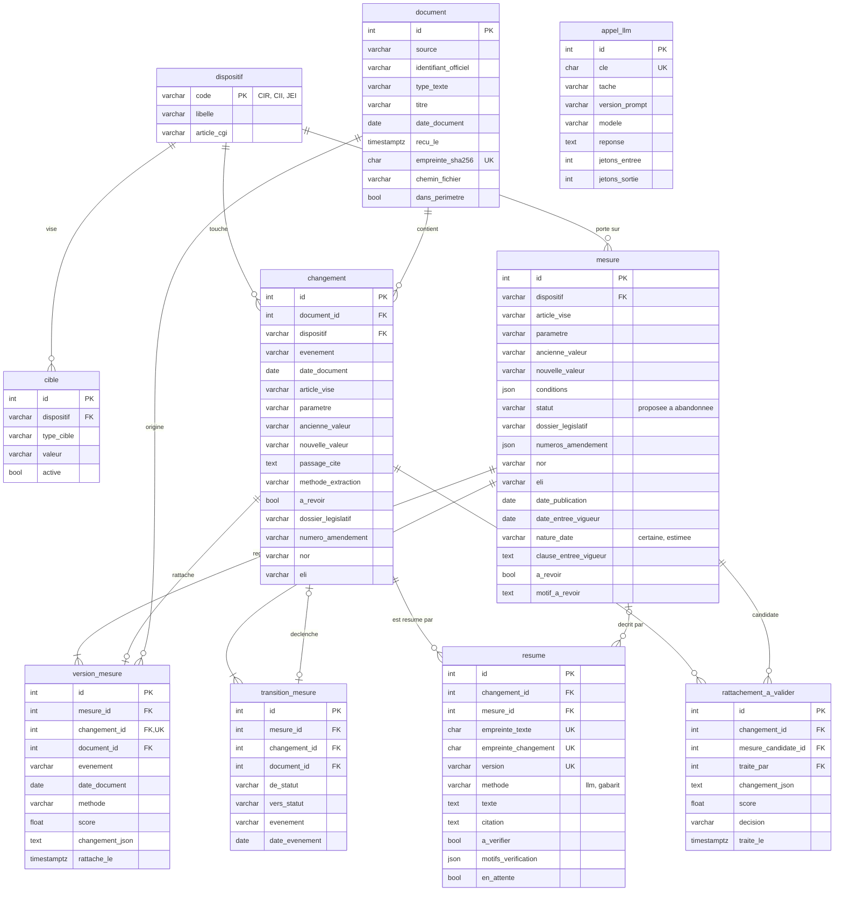
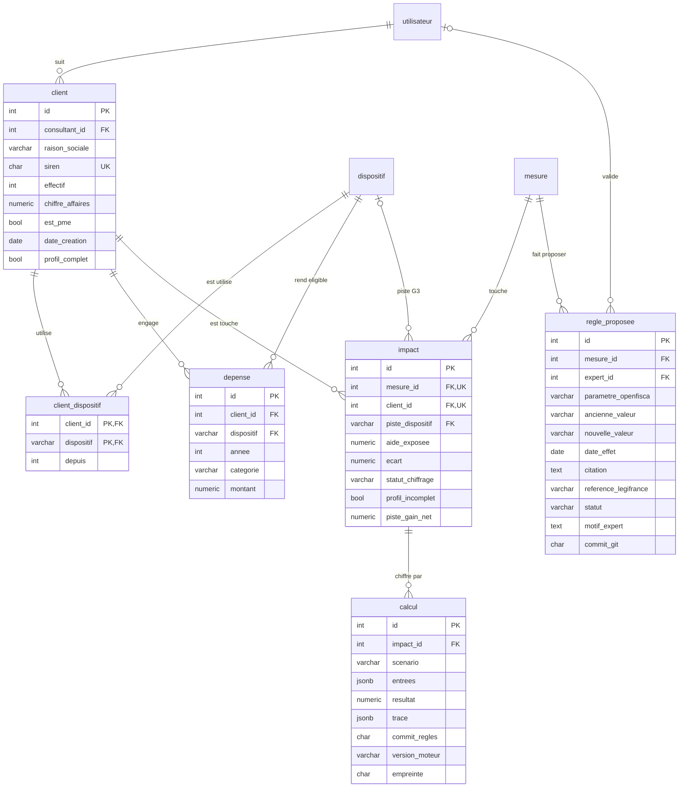
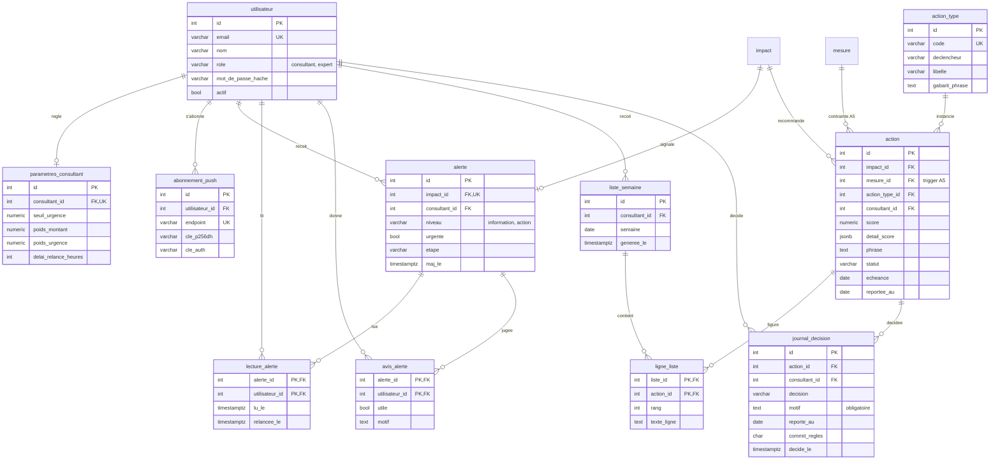

# 4 · Modèle logique des données (MLD) et contraintes

Le MLD traduit le [MCD](03_mcd.md) en tables relationnelles pour PostgreSQL. Règles de passage appliquées :

- une **entité** devient une table, son identifiant devient la clé primaire ;
- une association **(x,1)–(x,n)** devient une clé étrangère du côté (x,1) ;
- une association **(x,n)–(x,n)**, ou porteuse de données, devient une table dont la clé est composée des deux clés étrangères ;
- exception propre au projet : **une table, un propriétaire**. Quand la clé étrangère tomberait dans la table d'un autre lot, on crée une table de liaison chez le lot qui écrit (cas de `version_mesure`).

Notation : clé primaire en **gras**, clé étrangère précédée de `#`, ⚑ = unique.

## Schéma relationnel

### Référentiel · P5

- **dispositif** (**code**, libelle, article_cgi)

### Lot 1 · Collecter et détecter · P1

- **document** (**id**, source, identifiant_officiel, type_texte, titre, date_document, recu_le, empreinte_sha256 ⚑, chemin_fichier, dans_perimetre)
- **cible** (**id**, #dispositif → dispositif, type_cible, valeur, active)
- **changement** (**id**, #document_id → document, #dispositif → dispositif, evenement, date_document, article_vise, parametre, ancienne_valeur, nouvelle_valeur, passage_cite, methode_extraction, a_revoir, motif_a_revoir, dossier_legislatif, numero_amendement, nor, eli, detecte_le)

### Lot 2 · Comprendre et suivre la mesure · P2

- **mesure** (**id**, #dispositif → dispositif, article_vise, parametre, ancienne_valeur, nouvelle_valeur, conditions, statut, dossier_legislatif, numeros_amendement, nor, eli, date_publication, date_entree_vigueur, nature_date, clause_entree_vigueur, a_revoir, motif_a_revoir, cree_le, maj_le)
- **version_mesure** (**id**, #mesure_id → mesure, #changement_id → changement ⚑, #document_id → document, evenement, date_document, methode, score, changement_json, rattache_le)
- **transition_mesure** (**id**, #mesure_id → mesure, #changement_id → changement, #document_id → document, de_statut, vers_statut, evenement, date_evenement, cree_le)
- **resume** (**id**, #changement_id → changement, #mesure_id → mesure, empreinte_texte, empreinte_changement, version, methode, texte, citation, a_verifier, motifs_verification, en_attente, cree_le) — ⚑ (empreinte_texte, empreinte_changement, version)
- **rattachement_a_valider** (**id**, #changement_id → changement, #mesure_candidate_id → mesure, #traite_par → utilisateur, changement_json, score, decision, traite_le, cree_le)
- **appel_llm** (**id**, cle ⚑, tache, version_prompt, modele, reponse, jetons_entree, jetons_sortie, cree_le)

### Lot 3 · Cibler et chiffrer · P3

- **client** (**id**, #consultant_id → utilisateur, raison_sociale, siren ⚑, effectif, chiffre_affaires, est_pme, date_creation, profil_complet)
- **client_dispositif** (**#client_id → client, #dispositif → dispositif**, depuis)
- **depense** (**id**, #client_id → client, #dispositif → dispositif, annee, categorie, montant) — ⚑ (client_id, dispositif, annee, categorie)
- **impact** (**id**, #mesure_id → mesure, #client_id → client, #piste_dispositif → dispositif, aide_exposee, ecart, statut_chiffrage, profil_incomplet, piste_gain_net, calcule_le) — ⚑ (mesure_id, client_id)
- **calcul** (**id**, #impact_id → impact, scenario, entrees, resultat, trace, commit_regles, version_moteur, empreinte, calcule_le)
- **regle_proposee** (**id**, #mesure_id → mesure, #expert_id → utilisateur, parametre_openfisca, ancienne_valeur, nouvelle_valeur, date_effet, citation, reference_legifrance, statut, motif_expert, commit_git, proposee_le, traitee_le)

### Lot 4 · Alerter et agir · P4

- **parametres_consultant** (**id**, #consultant_id → utilisateur ⚑, seuil_urgence, poids_montant, poids_urgence, delai_relance_heures)
- **alerte** (**id**, #impact_id → impact ⚑, #consultant_id → utilisateur, niveau, urgente, etape, creee_le, maj_le)
- **lecture_alerte** (**#alerte_id → alerte, #utilisateur_id → utilisateur**, lu_le, relancee_le)
- **avis_alerte** (**#alerte_id → alerte, #utilisateur_id → utilisateur**, utile, motif, donne_le)
- **action_type** (**id**, code ⚑, declencheur, libelle, gabarit_phrase)
- **action** (**id**, #impact_id → impact, #mesure_id → mesure, #action_type_id → action_type, #consultant_id → utilisateur, score, detail_score, phrase, statut, echeance, reportee_au, creee_le)
- **liste_semaine** (**id**, #consultant_id → utilisateur, semaine, generee_le) — ⚑ (consultant_id, semaine)
- **ligne_liste** (**#liste_id → liste_semaine, #action_id → action**, rang, texte_ligne)

### Lot 5 · Plateforme · P5

- **utilisateur** (**id**, email ⚑, nom, role, mot_de_passe_hache, actif, cree_le)
- **abonnement_push** (**id**, #utilisateur_id → utilisateur, endpoint ⚑, cle_p256dh, cle_auth, cree_le)
- **journal_decision** (**id**, #action_id → action, #consultant_id → utilisateur, decision, motif, reporte_au, commit_regles, decide_le)

### Redondances voulues

| Colonne | Se déduit de | Pourquoi on la garde |
|---|---|---|
| `action.mesure_id` | `action.impact_id → impact.mesure_id` | Le trigger A5 vérifie le statut sans jointure, et toute insertion directe est contrôlée |
| `alerte.consultant_id`, `action.consultant_id` | `impact.client_id → client.consultant_id` | La Row-Level Security filtre chaque table sur sa propre colonne |
| `calcul.entrees` | `client`, `depense` | Rejouer un calcul passé à l'identique, même si le profil a changé (M5) |

## Diagrammes physiques

Types PostgreSQL. `PK` clé primaire, `FK` clé étrangère, `UK` unique.

### Veille et mesure



### Clients et chiffrage



### Alertes, actions et plateforme



## Contraintes d'intégrité

Le MCD ne sait pas tout exprimer. Ces règles sont ajoutées en base, pour qu'aucun module ne puisse les contourner.

| Règle | Mise en œuvre | Table | Lot |
|---|---|---|---|
| RG1 · Pas d'action sur une mesure non votée (A5) | Trigger `a5_action_mesure_votee` (déjà écrit : `leypilot/mesure/sql/a5_action_mesure_votee.sql`) | `action` | P2 écrit, P4 installe |
| RG2 · Aucun montant sans règle validée | `CHECK (statut_chiffrage <> 'chiffre' OR ecart IS NOT NULL)` et calcul fait seulement avec des règles au commit validé | `impact` | P3 |
| RG6 · Un consultant ne voit que son portefeuille | Row-Level Security | `client`, `impact`, `alerte`, `action`, `liste_semaine` | P4 |
| G5 · Motif obligatoire | `CHECK (length(trim(motif)) > 0)` | `journal_decision` | P5 |
| G6 · Journal non modifiable | `REVOKE UPDATE, DELETE` + trigger qui refuse | `journal_decision` | P5 |
| Valeurs d'énumération | `CHECK (statut IN (...))`, déjà généré par SQLAlchemy pour le lot 2 | toutes | chaque lot |
| Un texte n'est traité qu'une fois | `UNIQUE (empreinte_sha256)` | `document` | P1 |
| Un résumé n'est jamais refait | `UNIQUE (empreinte_texte, empreinte_changement, version)` | `resume` | P2 |

Exemples SQL (à placer dans les migrations Alembic) :

```sql
-- RG6 : chaque consultant ne lit que ses clients.
-- L'API fixe l'utilisateur au début de chaque requête : SET leypilot.utilisateur_id = '12';
ALTER TABLE client ENABLE ROW LEVEL SECURITY;
CREATE POLICY portefeuille ON client
    USING (consultant_id = current_setting('leypilot.utilisateur_id')::int);

-- G6 : le journal n'accepte que des ajouts.
REVOKE UPDATE, DELETE ON journal_decision FROM leypilot_app;
CREATE FUNCTION journal_refuser_modification() RETURNS trigger LANGUAGE plpgsql AS $$
BEGIN
    RAISE EXCEPTION 'journal_decision : modification et suppression interdites';
END;
$$;
CREATE TRIGGER journal_ajout_seul
    BEFORE UPDATE OR DELETE ON journal_decision
    FOR EACH ROW EXECUTE FUNCTION journal_refuser_modification();
```

## Propriétaires et lecteurs

| Table | Écrit par | Lu par |
|---|---|---|
| dispositif | P5 | tous |
| document, cible, changement | P1 | P2 |
| mesure, version_mesure, transition_mesure, resume, rattachement_a_valider | P2 | P3 (cascade), P5 (écrans) |
| appel_llm | P2 (couche LLM, pour le compte de tous) | P5 (suivi du budget) |
| client, client_dispositif, depense, impact, calcul, regle_proposee | P3 | P4, P5 |
| parametres_consultant, alerte, lecture_alerte, avis_alerte, action_type, action, liste_semaine, ligne_liste | P4 | P5 |
| utilisateur, abonnement_push, journal_decision | P5 | P4 |

Exception assumée : les écrans de P5 enregistrent les gestes des utilisateurs dans les tables des autres lots (clic « Lu », avis, décision de rattachement, validation d'une règle) **en appelant la fonction du lot propriétaire**, jamais par un `INSERT` direct. Exemple : l'écran de rattachement appelle `SuiviMesures.confirmer_rattachement()`.

## Écarts avec le code actuel

Ce que la conception demande et que le code ne fait pas encore.

| Écart | Où | À faire | Qui |
|---|---|---|---|
| `changement_id`, `document_id` sont des entiers sans clé étrangère | `version_mesure`, `transition_mesure`, `resume`, `rattachement_a_valider` | Ajouter les clés étrangères quand la table `changement` de P1 existera | P2 avec P1 |
| `dispositif` est un texte contrôlé par une énumération Python, sans table de référence | `mesure` | Créer la table `dispositif` ; les valeurs (CIR, CII, JEI) sont déjà identiques, donc pas de reprise de données | P5 |
| Qui a tranché un rattachement n'est pas enregistré | `rattachement_a_valider` | Ajouter `traite_par` et le paramètre correspondant à `confirmer_rattachement` / `refuser_rattachement` | P2 |
| Colonne `action.mesure_id` attendue par le trigger A5 | table `action` | La créer, puis appeler `installer_contrainte_a5()` dans la migration | P4 |
| Aucune migration Alembic | `migrations/` | Générer la première migration depuis les modèles | P5 |
