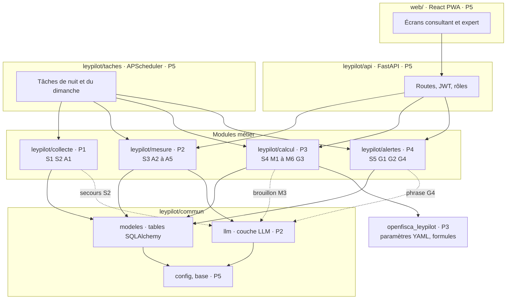
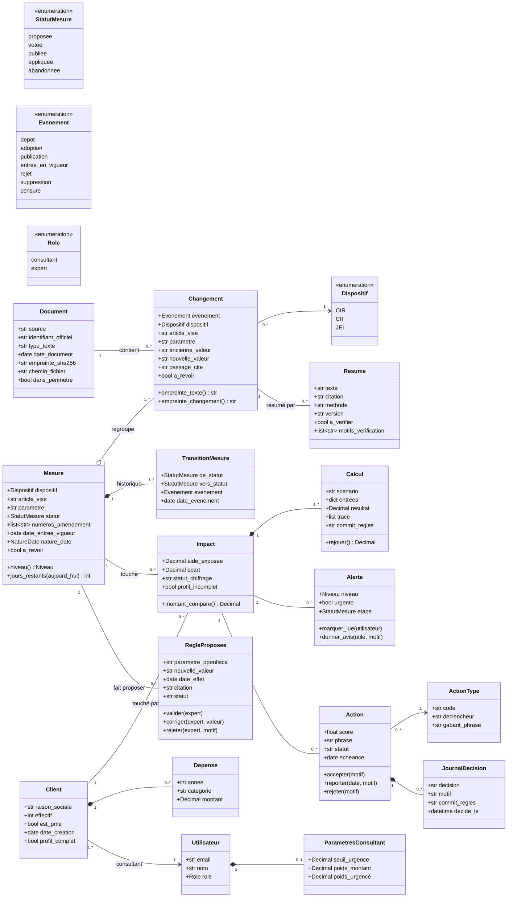
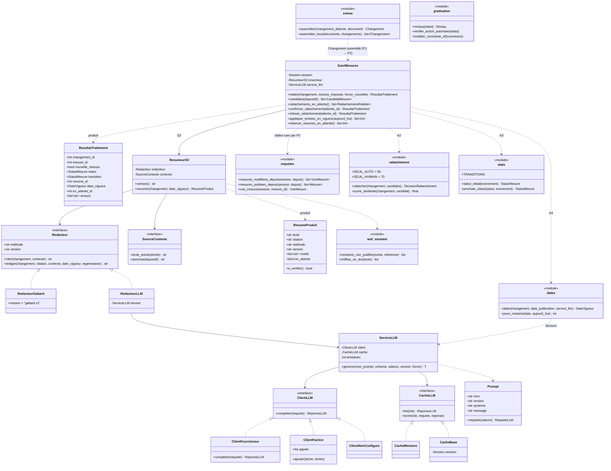

# 5 · Diagrammes de classes

Trois niveaux :

1. **Paquetages** : les modules Python et leurs dépendances.
2. **Modèle du domaine** : les objets métier, leurs attributs principaux et leurs opérations (toute la solution).
3. **Conception du lot 2** : les classes réellement codées dans `leypilot/mesure/` et `leypilot/commun/llm/`.

## 1 · Diagramme de paquetages

Une flèche signifie « dépend de » (importe ou lit les tables de).

Règles de dépendance :

- un module métier **n'importe jamais un autre module métier** : il lit ses tables, ou une fonction de lecture publiée (`leypilot.mesure.requetes`) ;
- seule `leypilot/commun` est partagée ;
- l'API et les tâches sont les seuls points d'entrée.

## 2 · Modèle du domaine

Choix notables :

- **Composition** (losange plein) quand la partie n'existe pas sans le tout : une transition sans sa mesure, un calcul sans son impact, une entrée de journal sans son action.
- **Agrégation** (losange vide) entre mesure et changements : le changement appartient au lot 1 et existe avant d'être rattaché.
- Les opérations de `Action` (`accepter`, `reporter`, `rejeter`) écrivent toujours une `JournalDecision` ; il n'y a pas d'opération qui modifie le journal.

## 3 · Conception du lot 2 (classes codées)

Ce diagramme reflète le code de la branche `branche-Papy`. Les interfaces (`<<interface>>`) sont des `Protocol` Python : on peut remplacer leur réalisation sans toucher au reste (exigence « Remplacer »).

Points de conception :

- **Deux contrats, deux modules** : `entree` assemble ce que fournit la personne 1 (documents filtrés + changements détectés) ; `requetes` expose les mesures à la personne 3.
- **`SuiviMesures` est la façade** du lot : la tâche de nuit et l'API n'appellent qu'elle. Elle ne fait jamais de `commit` ; c'est l'appelant qui valide la transaction.
- **Le LLM est optionnel** : sans fournisseur configuré, `creer_resumeur` choisit `RedacteurGabarit` et les dates se lisent par expressions régulières.
- **`ClientFournisseur.completer`** est la seule méthode à écrire quand le fournisseur sera choisi ; tout le reste (cache, nouvelles tentatives, validation Pydantic, filtre anti-montant) est déjà en place.
