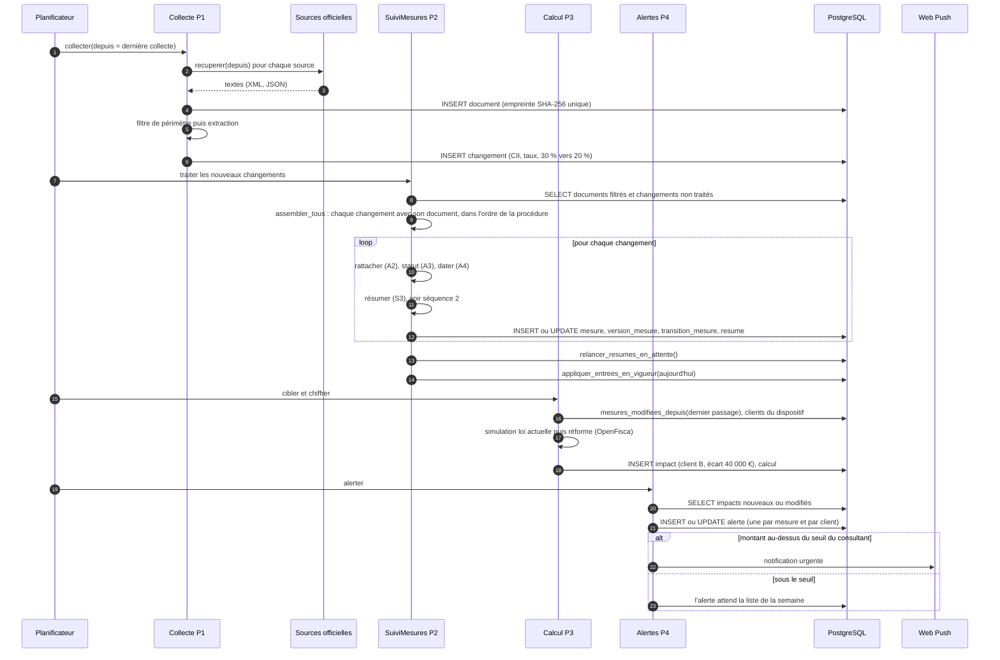
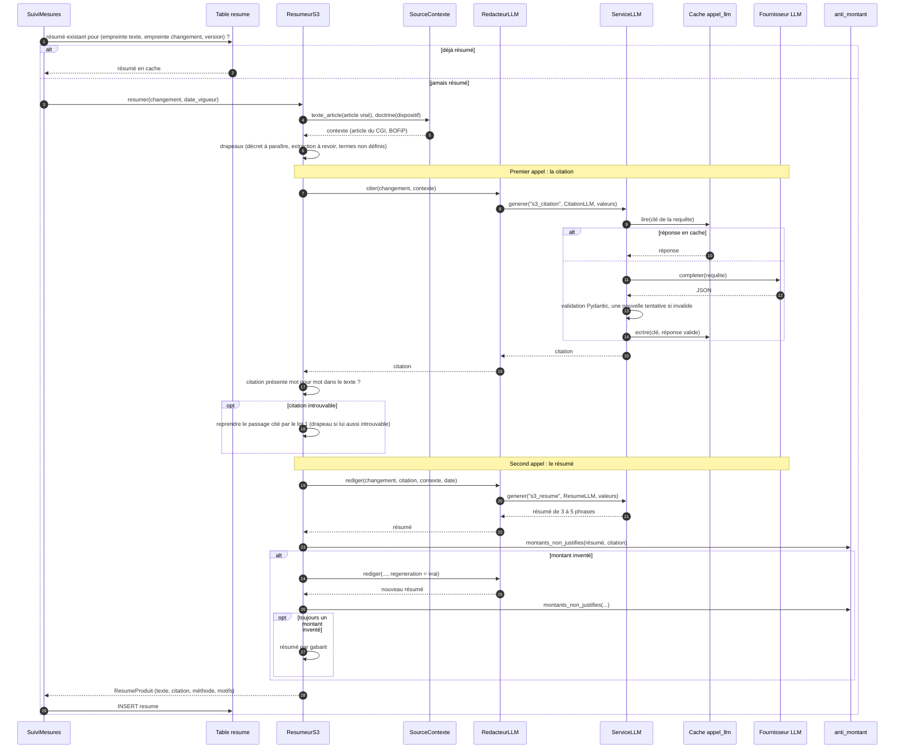
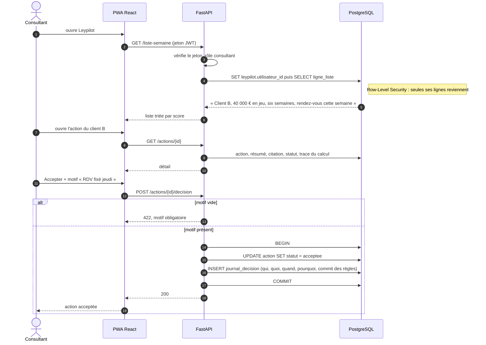
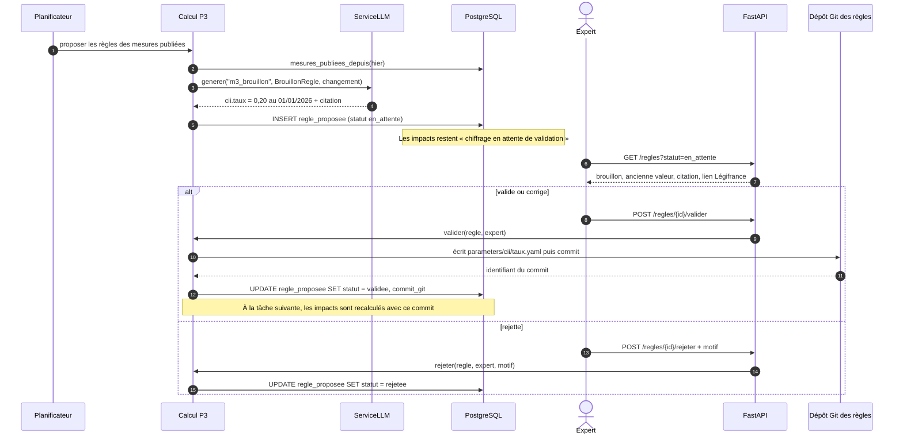

# 6 · Diagrammes de séquence

Quatre scénarios, du plus général au plus précis. Tous suivent le **client B**.

## 1 · La tâche de nuit, de bout en bout

Chaque nuit, le planificateur enchaîne les lots dans l'ordre de la cascade P1 → P2 → P3 → P4. Chaque module lit les tables du précédent et écrit les siennes ; ils ne s'appellent jamais directement.

Une erreur dans un lot n'arrête pas les suivants : chaque lot traite ce qui est prêt, et reprend le reste à la nuit suivante.

## 2 · Résumer un changement (S3, lot 2)

Ce qui se passe dans `ResumeurS3.resumer()` quand un fournisseur LLM est configuré. Sans fournisseur, le rédacteur par gabarit remplace les appels au LLM. Si le LLM échoue encore après sa nouvelle tentative (`ErreurLLM`), le gabarit fournit un texte provisoire et le résumé est enregistré **en attente** ; `relancer_resumes_en_attente()` le refait à la tâche suivante.

## 3 · Le consultant décide d'une action (G5, G6)

Le lundi, le consultant ouvre la liste de la semaine et traite la ligne du client B.

Leypilot ne contacte jamais le client : aucune route de l'API n'envoie de message vers l'extérieur.

## 4 · L'expert valide une règle (M3, M4, M5)

Déclencheur : la loi qui baisse le CII est publiée au JO, la mesure passe à « publiée ».

