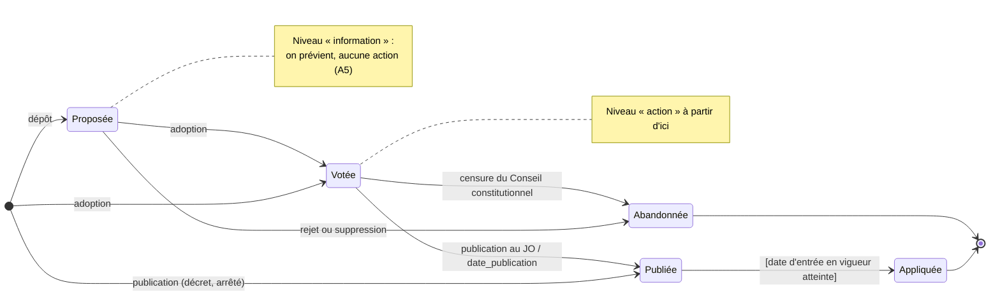
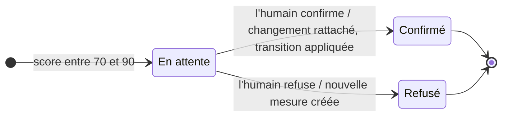
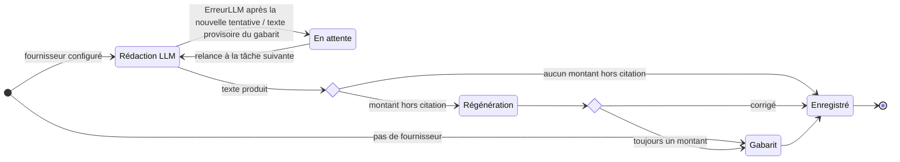
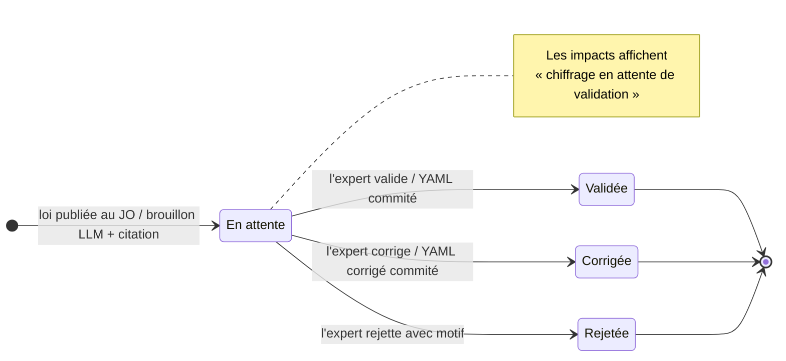
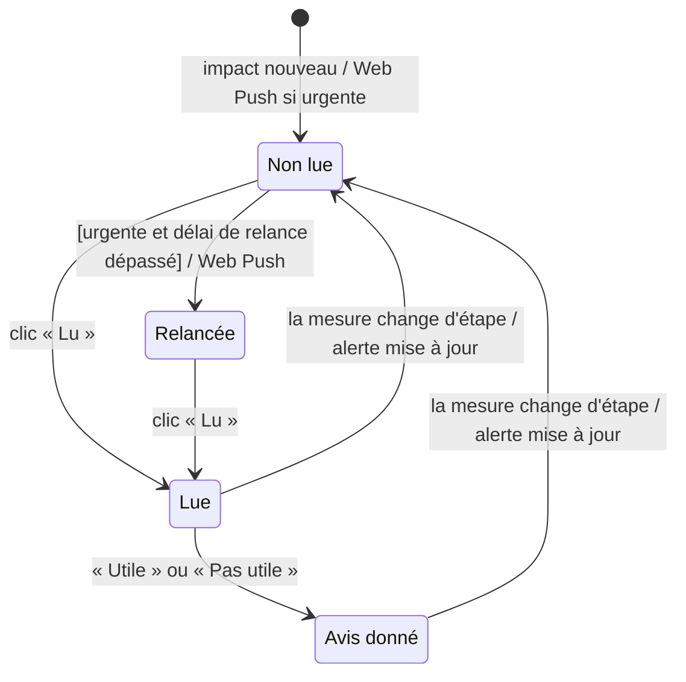
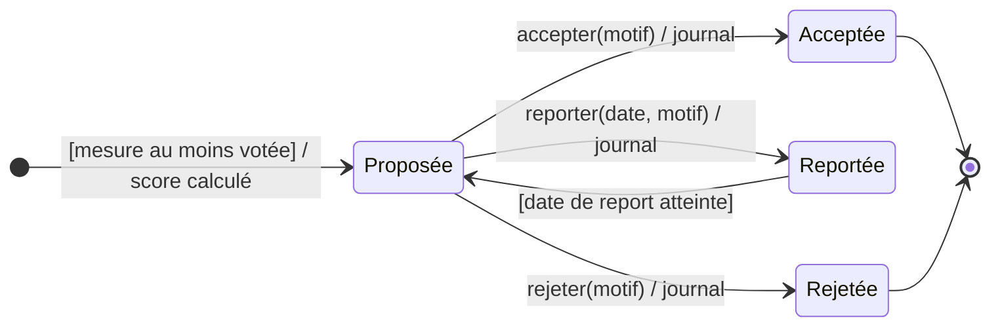

# 7 · Diagrammes d'états

Chaque objet qui a un cycle de vie a son diagramme. Une transition s'écrit `événement [condition] / effet`.

## 1 · Mesure (A3, lot 2) · conforme à `leypilot/mesure/etats.py`

| Règle | Comportement codé |
|---|---|
| Un événement qui confirme le statut actuel (deuxième amendement d'une mesure proposée) | Aucune transition ; la mesure est complétée (identifiants, résumé) |
| Une transition absente de la table (publication d'une mesure seulement proposée) | `TransitionInterdite` : le statut ne bouge pas, la mesure passe « à revoir » |
| Un rejet sur une mesure inconnue | Ignoré, signalé dans les erreurs du traitement |
| Passage en « appliquée » | Pas d'événement de la source : la tâche quotidienne `appliquer_entrees_en_vigueur` compare la date |
| Chaque transition | Une ligne dans `transition_mesure` (de, vers, événement, date) |

**Points ouverts** : statut « En attente de décret » entre Publiée et Appliquée, et cycle propre au BOFiP (consultation, publication). Ils s'ajoutent à la table `TRANSITIONS` sans toucher au reste.

## 2 · Rattachement à valider (A2, lot 2)

Une décision déjà prise ne peut plus être reprise (`RattachementIntrouvable`).

## 3 · Résumé (S3, lot 2)

Un résumé n'est jamais réécrit : on en crée un nouveau quand le changement, le texte ou la version du rédacteur change, ou quand un résumé en attente est relancé avec succès (le provisoire perd alors son drapeau « en attente »).

## 4 · Règle proposée (M3, M4, lot 3)

## 5 · Alerte (S5, lot 4)

Une seule alerte par mesure et par client, mise à jour à chaque étape de la mesure.

Une alerte n'est jamais supprimée : le seuil change l'urgence, pas la visibilité.

## 6 · Action (G1 à G5, lots 4 et 5)

La garde `[mesure au moins votée]` est garantie par le trigger A5 : la base refuse l'insertion sinon. Chaque transition déclenchée par le consultant ajoute une ligne dans `journal_decision`.
