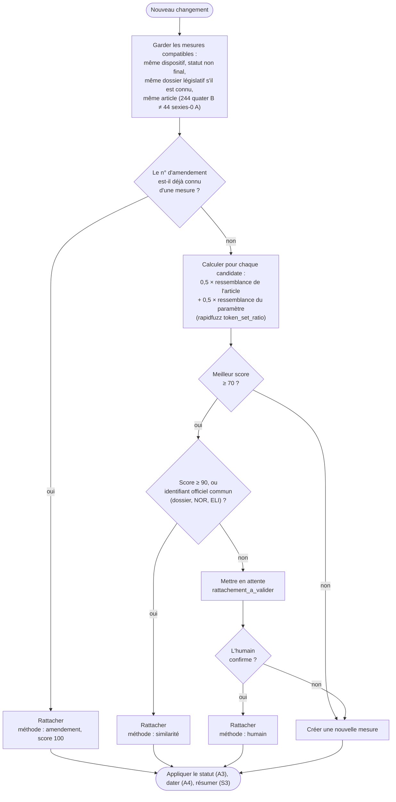
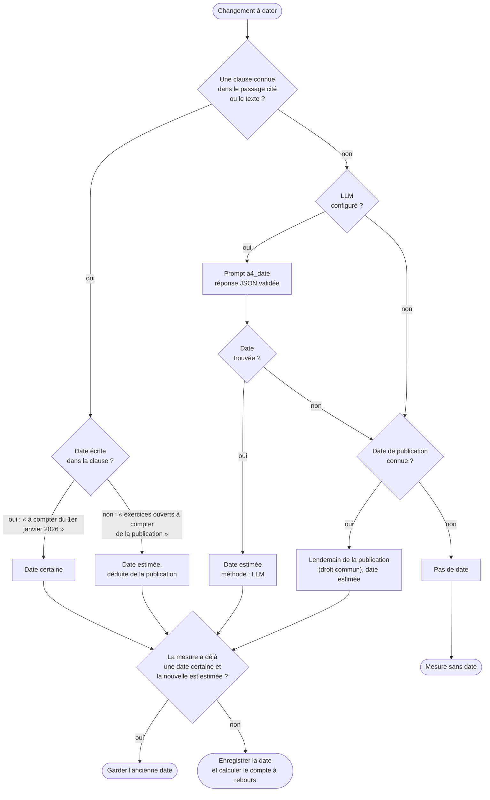
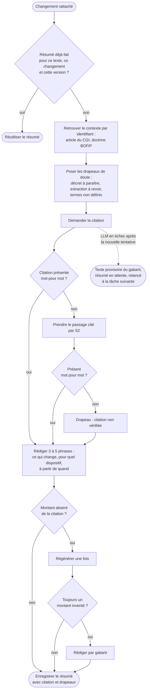
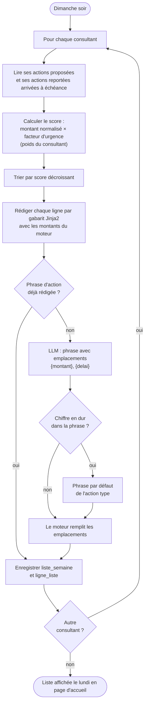

# 8 · Diagrammes d'activités

Les algorithmes qui portent des règles métier, décrits pas à pas. Losange = décision, rectangle arrondi = début ou fin.

## 1 · Rattacher un changement à une mesure (A2, lot 2)

Conforme à `leypilot/mesure/rattachement.py` et `suivi.py`.

**Fil rouge** : l'adoption du client B arrive avec un article écrit autrement (« CGI, art. 244 quater B, II, k » au lieu de « article 244 quater B du code général des impôts ») et sans numéro d'amendement. Le dossier législatif PLF2026 est commun : le changement est rattaché automatiquement à la même mesure (`donnees_exemple/lot2_client_b.json`).

## 2 · Dater l'entrée en vigueur (A4, lot 2)

## 3 · Résumer avec citation vérifiée (S3, lot 2)

## 4 · Produire la liste de la semaine (G1, G2, G4, lot 4)

Proposition à valider par la personne 4.

