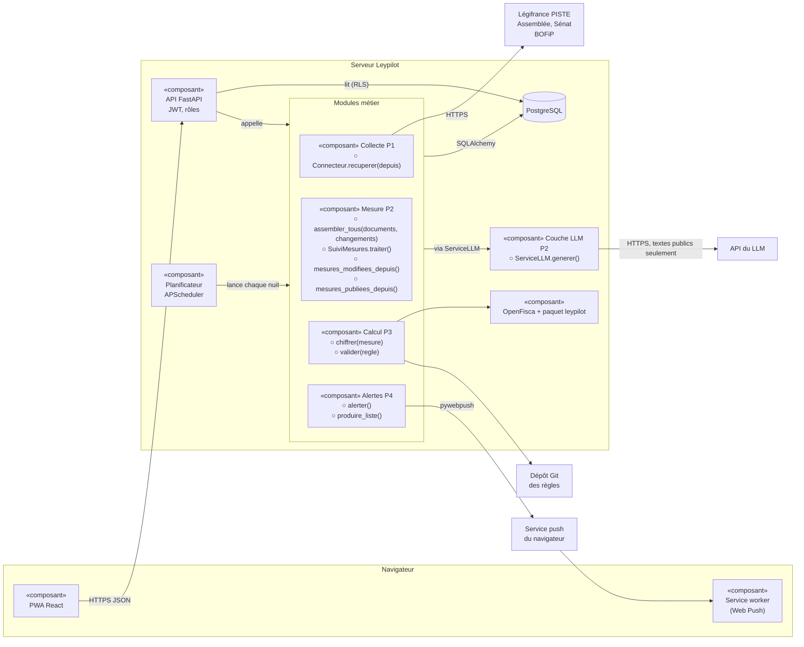
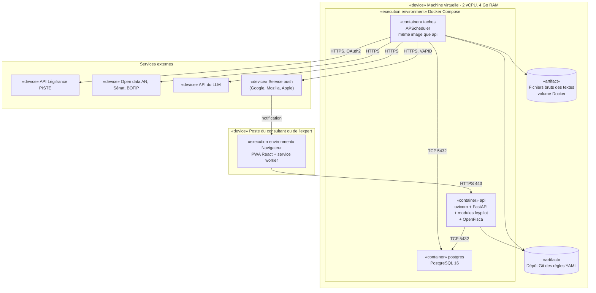

# 9 · Architecture : composants et déploiement

## 1 · Diagramme de composants

Chaque composant expose une interface (○) et n'en connaît pas l'implémentation. La couche LLM sert surtout le lot 2 (S3, A4) ; les autres lots l'appellent en secours (S2) ou pour M3 et G4. Les lots communiquent **par la base** (une table, un propriétaire) et par quelques fonctions de lecture publiées.

## 2 · Contrats entre lots

| De → vers | Ce qui passe | Forme | Déclencheur |
|---|---|---|---|
| P1 → P2 | Documents filtrés (texte, type, date, identifiants officiels) et changements détectés (dispositif, paramètre, ancienne et nouvelle valeur, passage cité) | Tables `document`, `changement` ; objets `DocumentFiltre`, `ChangementDetecte` (Pydantic, `leypilot/mesure/entree.py`) | Fin de la détection, chaque nuit |
| P2 → P3 | Mesures : dispositif, paramètre et valeurs, conditions, statut, niveau, date d'entrée en vigueur, résumé, documents | Tables `mesure`, `version_mesure`, `resume` ; fonctions `mesures_modifiees_depuis`, `mesures_publiees_depuis`, `vue_mesure` | Fin du suivi |
| P3 → P4 | Impacts chiffrés, trace, piste | Tables `impact`, `calcul` | Fin du chiffrage |
| P4 → P5 | Alertes, actions, liste de la semaine | Tables `alerte`, `action`, `liste_semaine` | Fin des alertes, dimanche soir |
| P2 → tous | Appel au LLM | `ServiceLLM.generer(nom_prompt, Schema, valeurs)` | À la demande |
| P5 → tous | Base, configuration, planificateur, API | `leypilot.commun`, `leypilot.taches` | — |

Le contrat P1 → P2 (`leypilot/mesure/entree.py`) est provisoire : il reste à valider avec la personne 1. Les données descendent en cascade : la personne 4 ne lit pas les mesures, elle reçoit niveau, date et résumé avec les impacts de la personne 3.

## 3 · Diagramme de déploiement

Tout tient sur une seule machine virtuelle, sans GPU. Le seul service externe qui reçoit des données est l'API du LLM, et il ne reçoit que des textes officiels publics.

## 4 · Tâches planifiées

Horaires proposés, à fixer par la personne 5 avec chaque lot.

| Tâche | Quand | Lot | Fait quoi |
|---|---|---|---|
| Collecte | Chaque nuit, 2 h ; toutes les 4 à 6 h d'octobre à décembre (PLF) | P1 | S1, A1 : textes nouveaux depuis le dernier passage |
| Contrôle de complétude | Chaque matin, 6 h | P1 | Compare au sommaire du JO, alerte technique si écart |
| Détection | Après la collecte | P1 | S2 : changements |
| Suivi des mesures | Après la détection | P2 | A2 à A5, S3 |
| Entrées en vigueur | Chaque jour, 0 h 30 | P2 | `appliquer_entrees_en_vigueur(aujourd'hui)` |
| Ciblage et chiffrage | Après le suivi | P3 | S4, M2, G3 ; M3 pour les mesures publiées |
| Alertes | Après le chiffrage | P4 | S5 : création, mise à jour, Web Push urgent |
| Relances | Toutes les heures | P4 | Alertes urgentes non lues après le délai |
| Liste de la semaine | Dimanche, 20 h | P4 | G1, G2, G4 |

Les tâches de la nuit s'enchaînent dans l'ordre de la cascade ; chacune ne traite que ce que la précédente a produit.

## 5 · Sécurité

| Exigence | Mise en œuvre |
|---|---|
| Un consultant ne voit que son portefeuille | JWT → `SET leypilot.utilisateur_id` → Row-Level Security sur les tables client, impact, alerte, action |
| L'expert ne voit pas les données client | Rôle `expert` : routes des règles et des rattachements seulement |
| Aucune donnée client vers le LLM | Les prompts ne reçoivent que des textes officiels et des champs de `Changement` ; les phrases G4 utilisent des emplacements remplis après coup par le moteur |
| Secrets hors du dépôt | `.env` (clé LLM, identifiants PISTE, secret JWT, clés VAPID), jamais commité |
| Journal non modifiable | Droits retirés + trigger sur `journal_decision` |
